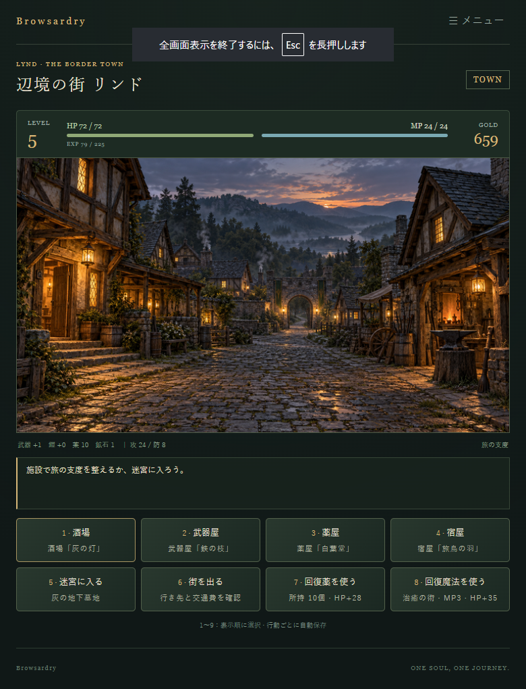
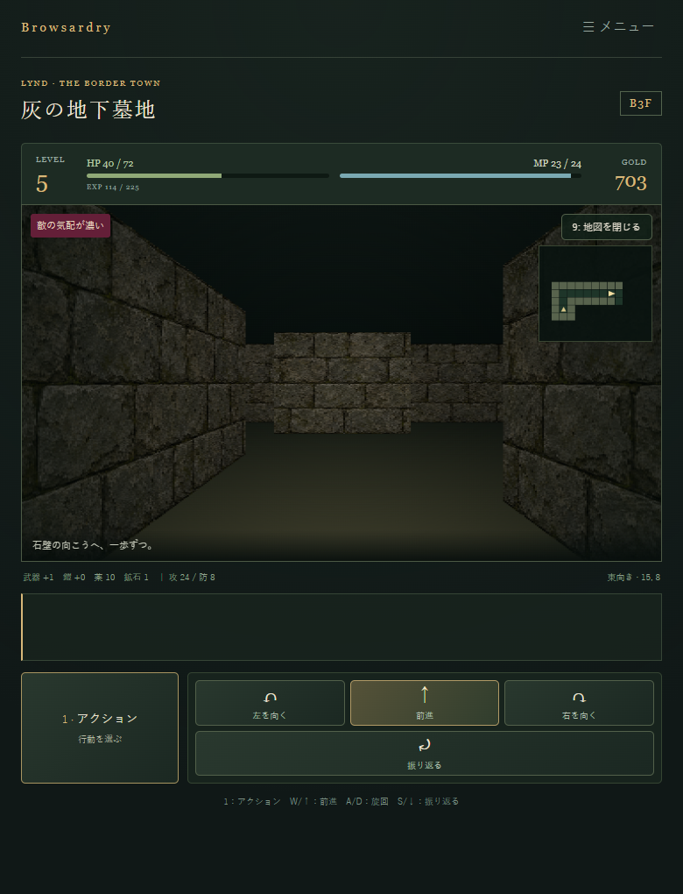
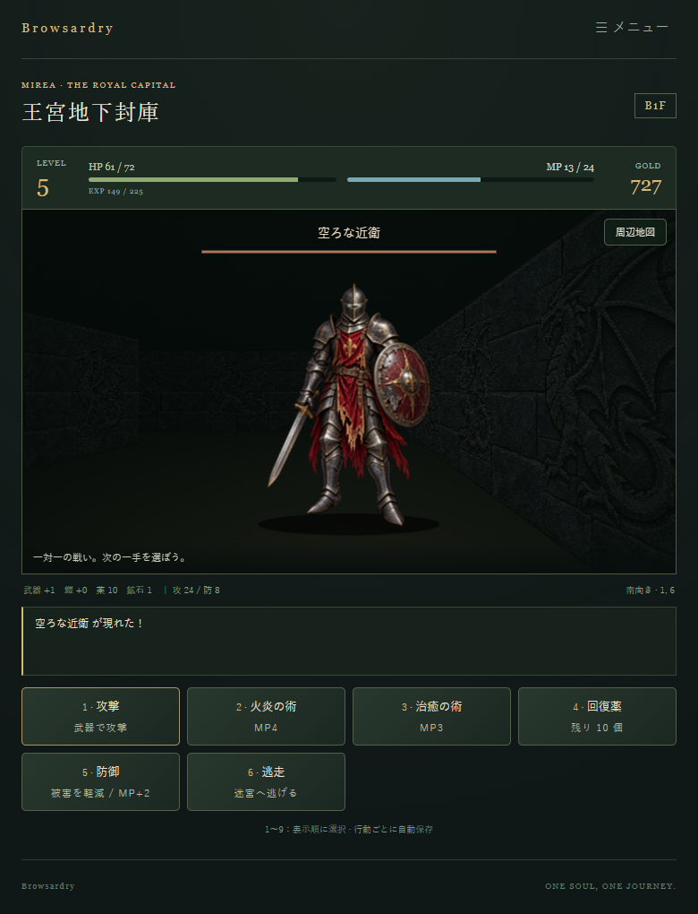

# Browsardry

**[実際に遊べる公開版はこちら](https://chocomintice.ccsp.mydns.jp/HPStore/web-benri-tools/Browsardry/)**

ブラウザーで遊べる、一人用のダンジョンRPGです。システムはシンプルなウィザードリーのようなもので、一人称視点で迷宮を探索し、敵と戦い、街へ戻って次の冒険に備えます。

シンプルなダンジョンRPGを作りたい、という用途に応えるベース・フレームワークのベアボーンとして作りました。探索・戦闘・街の施設・装備強化・セーブなど、ゲームの土台となる仕組みを備えています。自分のダンジョンRPGを制作する出発点として使っていただければ幸いです。

**ゲームバランスの調整は微妙です。ご了承ください。**

## スクリーンショット

| 街で冒険の準備 | 迷宮の探索 | 敵との戦闘 |
| --- | --- | --- |
|  |  |  |

## どんなゲーム？

街の酒場で情報を集め、薬屋や宿屋で準備を整えて迷宮へ向かいます。迷宮では地図を埋めながら階段や宝箱を探し、持ち帰った魔法の鉱石で武器・防具を強化して、さらに奥へ進みます。

- 3つの街と、全21階からなる3つの迷宮。
- 一人称視点のマス移動と、コマンド選択式の戦闘。
- 酒場の会話、回復薬の購入、宿泊、装備強化。
- 到達済みの階へ移動できる転移の術と、街へ戻る帰還の術。
- 行動ごとのオートセーブ。PCのキーボード操作とスマートフォンの画面ボタンに対応。

各地の迷宮にいる守護者を倒し、街に平穏を取り戻すのが冒険の目的です。

## ダンジョンの自動生成

ダンジョンマップには、作者が過去に制作した自動生成アルゴリズムを採用しています。考え方は次の2つの記事で紹介しています。

- [RPGのダンジョンマップらしきものを自動生成する(C#)](https://stackprobe.hateblo.jp/entry/2019/10/21/011102)
  壁と通路をランダムに置き、周囲3×3マスの壁の数に応じてマスを更新していく方法です。更新規則を表す「パターン」を変えることで、異なる形の地形を作ります。
- [RPGのダンジョンマップを自動生成する(C#)](https://stackprobe.hateblo.jp/entry/2019/10/29/230108)
  生成した地形の孤立した空間を、壁を開けてつなぎます。つなげられない空間は埋め、通路での距離が離れた場所を探して入口と終点を置くことで、探索できる迷宮に仕上げます。

本作では**パターン24と79を、各迷宮の地下1階から階ごとに交互に使用**しました。生成した候補を採用・調整したマップを収録しているため、プレイ中や再読込のたびに地形が変わることはありません。

## 遊び方

`DocRoot/index.html` をブラウザーで開くと起動します。保存して遊ぶ場合は、`DocRoot` の内容をWebサーバーに配置し、HTTP(S)でアクセスしてください。ライブラリのインストールやビルドは不要です。

PCでは `W` / `↑` で前進、`A`・`D` / `←`・`→` で旋回、`S` / `↓` で振り返ります。`1` でアクションを開き、メニューの項目は数字キーで選べます。出口・階段・宝箱・鉱石は、足元で「調べる」を選んで利用します。スマートフォンでは画面上のボタンで操作できます。

進行状況はブラウザーに保存されます。同じ配信元・同じブラウザーで続きを遊んでください。ブラウザーの保存データを削除した場合や、配信元・ブラウザーを変えた場合には自動で引き継がれません。

## 制作・改造する方へ

HTML / JavaScript / Canvasで実装しています。街・マップ・敵のデータは `DocRoot/data/` にまとめてあり、名前や配置、能力、画像などを編集できます。

- [開発方針と文書案内](AGENTS.md)
- [開発・実装仕様、配置・検証手順](DEVELOPMENT.md)
- [街・マップ・敵データの編集](DATA.md)
- [画像素材の仕様](ART.md)
- [ダンジョン制作手順](AGENTS_HowToCreateDungeonMap.md)
- [開発環境でのテストプレイ方法](AGENTS_HowToTestPlay.md)
